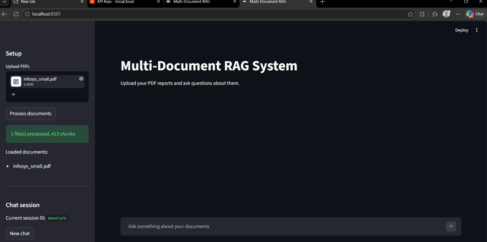
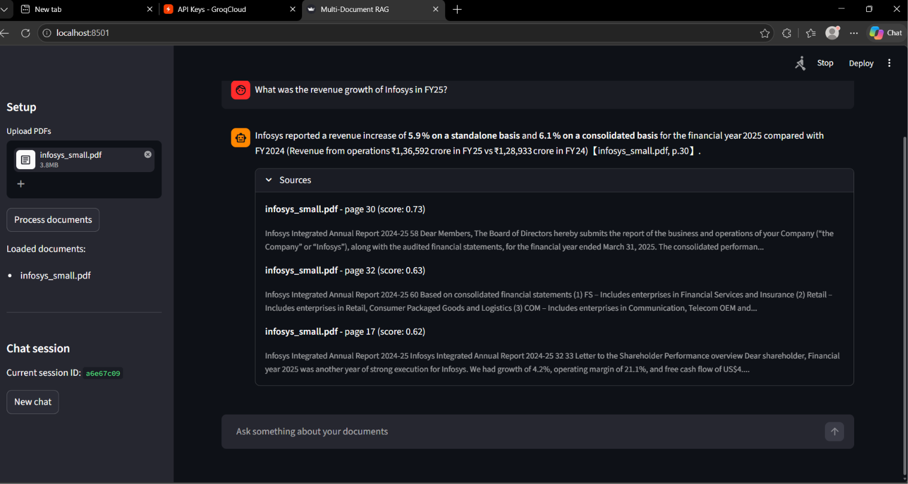
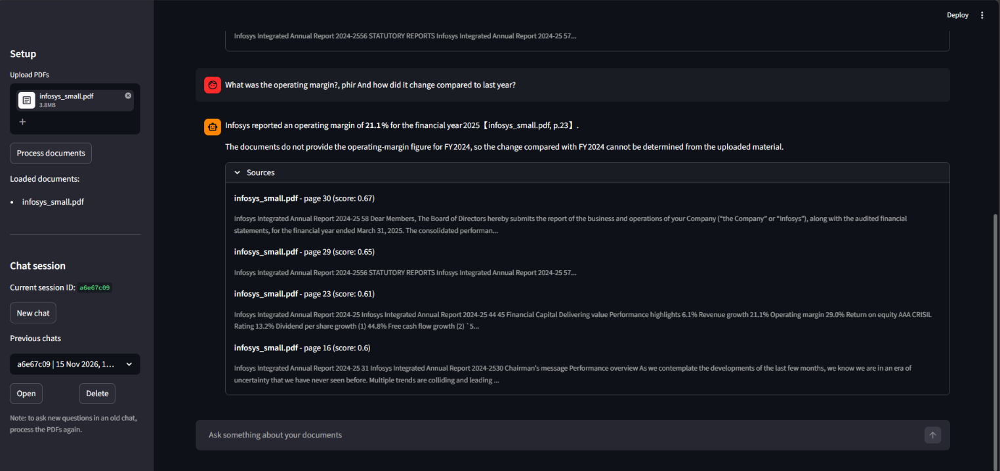
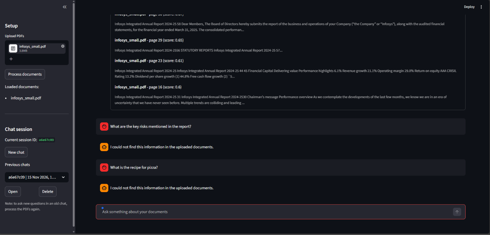
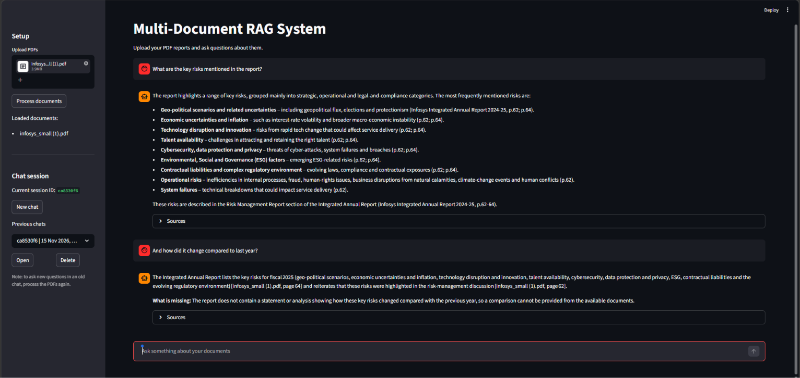
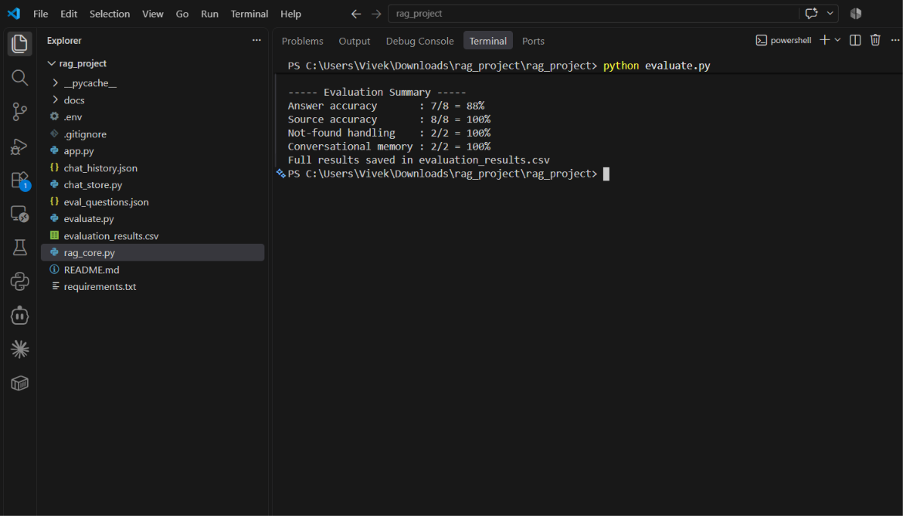

# Assignment 3: Multi-Document RAG System

This is a RAG (Retrieval-Augmented Generation) app. You can upload multiple PDF reports
and ask questions about them. The answers come from the documents and the app shows
which file and page was used.

## What it can do
- Upload more than one PDF
- Answer questions only from the uploaded documents
- Show sources (file name, page number, text snippet)
- Say "not found" when the answer is not in the documents
- Remember the chat, so follow-up questions work ("what about last year?")
- Every chat has its own session ID, and chats are saved in `chat_history.json`
- Old chats can be opened again or deleted, and a new chat can be started anytime

## How it works
1. Text is taken out of each PDF page using pypdf
2. The text is cut into small chunks (800 characters, 150 overlap)
3. Each chunk is converted into an embedding using `all-MiniLM-L6-v2`
4. When the user asks a question, the follow-up is first rewritten into a full question using chat history
5. Relevant chunks are found using hybrid search: semantic (cosine similarity) + keyword matching, so numbers and table values are not missed
6. If the best similarity is too low, the app says the information is not available
7. Otherwise the chunks and the question go to the LLM (GPT-OSS 120B on Groq) to write the answer

## Files
- `app.py` - streamlit interface
- `rag_core.py` - main RAG logic
- `chat_store.py` - saves chat sessions (session ID + history)
- `evaluate.py` - testing script
- `eval_questions.json` - test questions
- `docs/` - sample PDFs for testing
- `screenshots/` - screenshots of the working app

Note: create a `.env` file with `GROQ_API_KEY=your_key` (see `.env.example`) before running.

## How to run
```
pip install -r requirements.txt
streamlit run app.py
```
Get a free API key from https://console.groq.com and put it in the `.env` file.
Then upload 2-3 PDFs, click "Process documents" and start asking questions.

## Sample documents
Annual / financial reports of companies in PDF format.

## Testing
Questions I tried:
- Simple fact: "What was the total revenue?"
- Multiple documents: "Compare the risks mentioned in both reports"
- Follow-up: "What was the net profit?" then "And how much was it last year?"
- Not in documents: "What is the recipe for pizza?" (app says not found)

## Screenshots

**1. Documents uploaded and processed** (chunks created, session ID shown)



**2. Answer with source references** (file name, page number, similarity score, text snippet)



**3. Another question with sources, and chat sessions** (session ID, previous chats, open / delete)



**4. Question not in the documents** (app says the information is not available)



**5. Key risks answer and follow-up question** (the follow-up "how did it change compared to last year?" uses the chat memory; the app also says what information is missing)



## Evaluation
`evaluate.py` runs the questions from `eval_questions.json` on the PDFs in `docs/`
and prints answer accuracy, source accuracy, not-found handling and memory accuracy.
```
export GROQ_API_KEY=your_key
python evaluate.py
```
Results are saved in `evaluation_results.csv`.

### Results
Test document: Infosys Integrated Annual Report 2024-25 (trimmed to 67 pages), 10 test questions
(6 fact questions, 1 summary question, 2 follow-up questions, 2 questions not present in the document).

| Metric | Result |
|---|---|
| Answer accuracy | 7/8 = 88% |
| Source accuracy | 8/8 = 100% |
| Not-found handling | 2/2 = 100% |
| Conversational memory | 2/2 = 100% |



Per question (last run): Q1-Q3 pass, **Q4 (return on equity) fail**, Q5-Q10 pass.

**Q4 failure analysis:** the system answered 44.8% for return on equity (page 22), but the report's value is 29.0%.
44.8% is the *free cash flow growth*. In the "Performance highlights" box of the PDF, each number is written
before its label, so the LLM matched the number to the wrong label. The correct chunk was retrieved, so the
problem is in how the LLM read the text layout, not in retrieval.
Full answers are saved in `evaluation_results.csv`.

### Improvements made after testing
- First run gave 62% answer accuracy and 0% source accuracy. Questions about numbers and tables
  (return on equity, free cash flow, last year's margin) were missed by semantic search alone.
- Added keyword matching along with semantic search (hybrid search), which fixed most of them.
- Increased the number of chunks sent to the LLM and changed the prompt so that partial answers are
  given with a note on what is missing, instead of a plain "not found".
- Added retry with waiting for the free API rate limit.
- The LLM output can change a little between runs (return on equity passed in an earlier run and failed in the last one).

## Limitations
- Scanned PDFs do not work (needs OCR)
- Numbers in tables can be read wrongly by the LLM, so important figures should be checked in the source page
- Index is stored in memory, so it is lost when the app restarts
- Could be improved with a vector database like FAISS or Chroma
